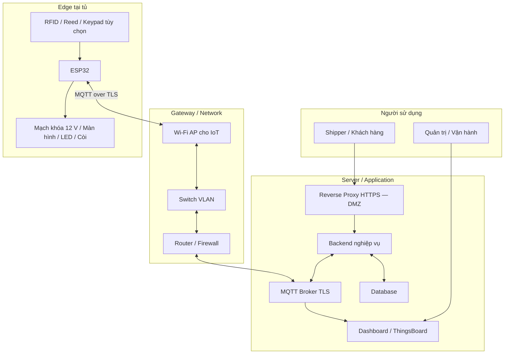
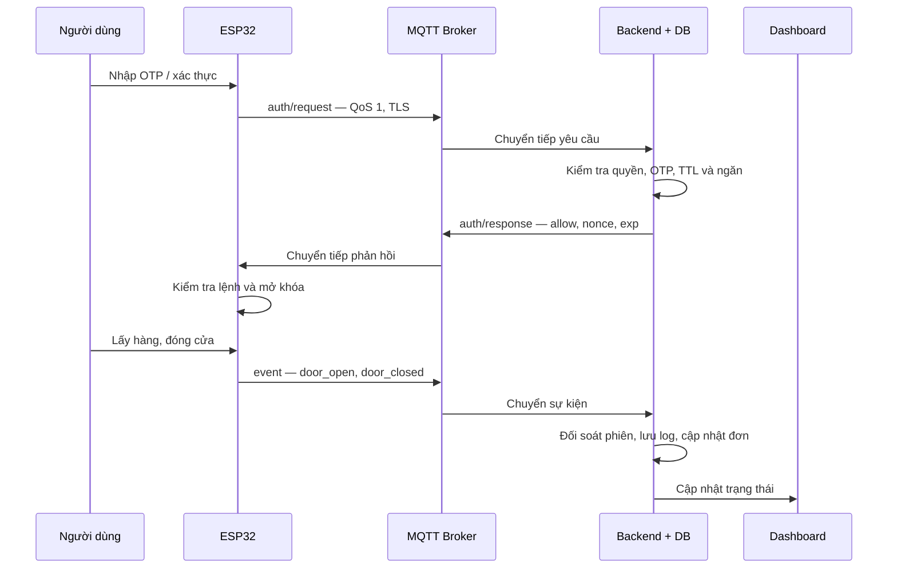

# TỔNG HỢP PROJECT IoT: TỦ KHÓA GIAO HÀNG THÔNG MINH

**Tên dự án:** Smart Locker – Tủ khóa giao hàng thông minh  
**Môn học:** Internet of Things (IoT)  
**Đề tài:** 67 – Nhóm N11  
**Phạm vi tài liệu:** Tổng hợp báo cáo giai đoạn 1, 2, 3 và các sơ đồ hệ thống được cung cấp.

> Tài liệu mô tả yêu cầu, thiết kế và kế hoạch triển khai. Các thông số hiệu năng là mục tiêu hoặc dự kiến; nguồn cung cấp chưa có kết quả kiểm thử để xác nhận hệ thống đã đạt các thông số này. Các phần được ghi “đề xuất thống nhất” là nội dung làm rõ để nối các giai đoạn thành một thiết kế nhất quán.

## 1. Tổng quan dự án

### 1.1. Bài toán thực tế

Trong giao hàng chặng cuối, khách hàng có thể vắng mặt khi shipper đến giao. Việc chờ đợi, nhờ người nhận hộ hoặc để hàng trước cửa làm tăng thời gian giao nhận và nguy cơ mất cắp, hư hỏng, thất lạc. Dự án xây dựng một tủ giao hàng kết nối IoT để shipper gửi hàng vào ngăn được cấp quyền và khách hàng chủ động đến nhận sau đó.

Hệ thống kết hợp điều khiển khóa tại thiết bị biên, xác thực quyền truy cập, giám sát trạng thái cửa và quản lý giao nhận tập trung. Người dùng không cần gặp trực tiếp nhưng các thao tác vẫn được ghi nhận phục vụ theo dõi, đối soát và xử lý sự cố.

### 1.2. Mục tiêu

- Mở đúng ngăn tủ cho đúng người, đúng thao tác giao hoặc nhận hàng.
- Quản lý vòng đời đơn hàng từ chờ giao đến đã gửi vào tủ và đã nhận.
- Theo dõi trạng thái cửa, kết nối thiết bị và lịch sử truy cập.
- Cảnh báo khi xác thực thất bại nhiều lần, cửa bị bỏ ngỏ hoặc mở không có lệnh hợp lệ.
- Mã hóa giao tiếp, cô lập mạng IoT và phân quyền thiết bị.
- Duy trì chức năng cục bộ, lưu tạm sự kiện và đồng bộ khi kết nối phục hồi.

### 1.3. Hai mức phạm vi

| Hạng mục | Mô hình thử nghiệm môn học | Hướng hoàn thiện/mở rộng |
| --- | --- | --- |
| Quy mô | 1–2 tủ thu nhỏ, mỗi tủ một ESP32 | Nhiều tủ, nhiều ngăn và nhiều điểm đặt |
| Xác thực | RFID MFRC522 là phương thức chính theo giai đoạn 2 | OTP/QR theo đơn hàng; có thể kết hợp PIN hoặc phương thức khác |
| Phần cứng | ESP32, RFID, khóa 12 V, mạch công suất, Reed switch, màn hình, LED, buzzer | Load cell/HX711 hoặc cảm biến hiện diện cho từng ngăn; camera/bộ đọc mã kiện, keypad, cảm biến khói/nhiệt, chuyển động, UPS |
| Phần mềm | MQTT, Dashboard và chức năng quản lý cần thiết cho demo | Backend đầy đủ về người dùng, đơn hàng, ngăn tủ, OTP và báo cáo |
| Mạng | Mạng nội bộ; VLAN/firewall triển khai trên thiết bị hỗ trợ hoặc mô phỏng riêng | Hạ tầng phân đoạn VLAN thực tế, DMZ và truy cập Internet qua HTTPS |

Camera, cảm biến khói/nhiệt và chuyển động xuất hiện trong định hướng giai đoạn 1 nhưng chưa có cấu hình chi tiết tương ứng trong danh mục phần cứng giai đoạn 2. Vì vậy, chúng được giữ ở phạm vi mở rộng. Mô phỏng mạng chỉ kiểm chứng phần cấu hình/topology phù hợp, không thay thế kiểm thử toàn tuyến ESP32–MQTT–khóa thật.

## 2. Tác nhân và yêu cầu hệ thống

### 2.1. Các tác nhân

| Tác nhân | Quyền và thao tác chính |
| --- | --- |
| Shipper | Xác thực quyền giao, mở ngăn được cấp, gửi hàng và đóng cửa |
| Khách hàng | Nhận thông tin xác thực, mở ngăn chứa đơn của mình và lấy hàng |
| Quản trị viên | Quản lý thiết bị, đơn hàng, quyền truy cập, lịch sử và cảnh báo |
| Nhân sự bảo trì/vận hành | Kiểm tra thiết bị, mở tủ bảo trì theo quyền và xử lý sự cố có ghi log |

### 2.2. Yêu cầu chức năng

| Mã | Chức năng | Nội dung |
| --- | --- | --- |
| CN01 | Xác thực truy cập | Phân biệt quyền shipper/khách hàng; dùng RFID trong demo và OTP/QR trong nghiệp vụ đầy đủ |
| CN02 | Quản lý, điều khiển tủ | Chọn ngăn trống phù hợp kích thước khi có dữ liệu cấu hình; mở đúng ngăn và cập nhật trạng thái |
| CN03 | Phản hồi tại tủ | Hiển thị hướng dẫn, LED và còi báo thành công, lỗi, cảnh báo; chiếu sáng theo hiện diện khi có cảm biến |
| CN04 | Giám sát an toàn | Phát hiện cửa mở bất thường/cửa chưa đóng; bổ sung giám sát khói/nhiệt khi có phần cứng |
| CN05 | Theo dõi đơn hàng | Cập nhật chờ giao → đã gửi vào tủ/chờ nhận → đã nhận |
| CN06 | Đồng bộ cục bộ | Lưu sự kiện khi mất mạng và đồng bộ lại có thứ tự, chống ghi trùng |
| CN07 (đề xuất) | Xác minh kiện hàng | Đối chiếu mã kiện duy nhất với đơn; xác nhận vật xuất hiện/biến mất trong ngăn và lưu bằng chứng cùng phiên giao/nhận khi có phần cứng phù hợp |

### 2.3. Yêu cầu phi chức năng

| Mã | Yêu cầu | Định hướng đáp ứng |
| --- | --- | --- |
| PCN01 | Phản hồi mở tủ dưới 2 giây | MQTT thường trực, Backend gần Broker, truy vấn xác thực có chỉ mục |
| PCN02 | Bảo mật đường truyền | MQTT over TLS, HTTPS, kiểm tra chứng chỉ, VLAN và ACL |
| PCN03 | Tiết kiệm năng lượng | Tắt/giảm hoạt động màn hình và đèn khi không sử dụng, tùy phần cứng |
| PCN04 | Tính sẵn sàng | UPS, phát hiện mất kết nối, xử lý cục bộ và hàng đợi sự kiện |

## 3. Kiến trúc tổng thể

### 3.1. Từ mô hình IoT năm tầng đến ba lớp triển khai

| Tầng ở giai đoạn 1 | Lớp triển khai | Thành phần và trách nhiệm |
| --- | --- | --- |
| Sensing | Edge | ESP32 và ngoại vi: đọc RFID/cảm biến, thực thi điều khiển, phản hồi tại tủ |
| Network | Gateway/Network | Wi-Fi AP, switch VLAN, router/firewall: vận chuyển dữ liệu, định tuyến và lọc truy cập |
| Middleware | Server/Application | Broker, Backend, Database: trao đổi bản tin, xác thực, lưu trữ và đối soát |
| Application | Server/Application | Dashboard, Web/Mobile App: tương tác và giám sát |
| Business | Server/Application | Quản trị, phân quyền, thống kê, audit trail và xử lý sự cố |

ESP32 được đặt trong lớp Edge cùng các ngoại vi để phù hợp mô hình triển khai ở giai đoạn 3; vai trò kết nối Wi-Fi của ESP32 vẫn thuộc chức năng mạng theo cách phân tầng ban đầu.

### 3.2. Sơ đồ logic



Sơ đồ thể hiện quan hệ chức năng. Kết nối dữ liệu MQTT do ESP32 chủ động thiết lập; bản tin điều khiển quay về trên kết nối đang có. Dashboard nhận dữ liệu trực tiếp từ nền tảng hoặc qua tích hợp Backend tùy cấu hình được chọn.

### 3.3. Vai trò dịch vụ

| Dịch vụ | Vai trò |
| --- | --- |
| MQTT Broker | Xác thực thiết bị, phân quyền topic và định tuyến thông điệp |
| Backend API | Xử lý OTP/QR, quyền giao/nhận, cấp phát ngăn, cập nhật đơn hàng và chống xử lý trùng |
| Database | Lưu người dùng, tủ, ngăn, đơn hàng, quyền truy cập, sự kiện và lịch sử |
| ThingsBoard | Giám sát thiết bị, hiển thị telemetry/trạng thái và cảnh báo |
| Reverse Proxy Nginx | Điểm vào HTTPS cho Web/App, chuyển yêu cầu đến Backend |

**Đề xuất thống nhất:** chọn một phương án MQTT chính. Nếu dùng Mosquitto, triển khai cơ chế tích hợp để đưa dữ liệu đến ThingsBoard. Nếu dùng MQTT transport của ThingsBoard, ánh xạ bản tin sang telemetry, attributes và RPC của nền tảng. Không mặc định các topic tùy biến ở mục 7 hoạt động trực tiếp trên ThingsBoard mà không có bước ánh xạ.

## 4. Thiết kế phần cứng

### 4.1. Danh mục chính

| Thiết bị | Model/phương án | Chức năng |
| --- | --- | --- |
| Vi điều khiển | ESP32 DevKit V1 | Điều khiển, kết nối Wi-Fi 2,4 GHz và xử lý cục bộ |
| RFID | MFRC522 13,56 MHz | Đọc UID thẻ qua SPI |
| Khóa | Khóa chốt điện 12 V | Khóa/mở ngăn tủ |
| Mạch công suất | MOSFET logic-level hoặc relay phù hợp | Đóng cắt nguồn cấp cho khóa |
| Diode bảo vệ | 1N4007 hoặc loại phù hợp tải | Hạn chế điện áp ngược từ cuộn khóa |
| Cảm biến cửa | Reed switch | Đọc trạng thái cửa mở/đóng |
| Cảm biến khối lượng (bổ sung) | Load cell + HX711 cho từng ngăn | Đo thay đổi khối lượng trước/sau phiên giao hoặc nhận |
| Quan sát mã kiện (bổ sung) | Camera/bộ đọc mã nhìn được nhãn trên kiện trong ngăn | Đối chiếu mã trên kiện thực sự được đặt trong ngăn với mã kiện của đơn |
| Màn hình | LCD 16×2 I2C hoặc OLED SSD1306 | Hiển thị hướng dẫn và trạng thái |
| Còi và đèn | Buzzer 5 V, LED đỏ/xanh | Báo kết quả và cảnh báo |
| Nguồn | Adapter 12 V và buck LM2596 | Cấp nguồn cho khóa, bộ điều khiển và ngoại vi |
| Nút bảo trì | Push button | Thao tác mở phục vụ bảo trì theo thiết kế |

### 4.2. Nguyên tắc kết nối

- MFRC522 trao đổi với ESP32 qua SPI; màn hình dùng I2C theo module được chọn.
- Reed switch và các đầu vào được đọc qua GPIO với cấu hình điện trở và chống dội phù hợp.
- Nếu dùng load cell, nối qua HX711, hiệu chuẩn mức ngăn trống và đọc nhiều mẫu khi cửa đã đóng, giá trị đã ổn định. Chọn tải trọng và ngưỡng theo kiện nhẹ nhất dự kiến và sai số đo thực tế.
- Bố trí camera/bộ đọc mã để quan sát được nhãn trên kiện trong ngăn. Quét mã trước khi mở cửa không tự chứng minh kiện được quét là kiện đã đặt vào.
- GPIO điều khiển MOSFET/relay; khóa 12 V lấy nguồn qua mạch công suất.
- Adapter 12 V cấp cho nhánh khóa; buck tạo mức điện áp phù hợp cho nhánh điều khiển.
- Kiểm tra điện áp logic, dòng tải, dòng khởi động và sơ đồ nguồn theo linh kiện thực tế trước khi lắp ráp. Không cấp 12 V trực tiếp vào GPIO ESP32.

Tài liệu nguồn chưa chốt bảng GPIO, dòng khóa, công suất adapter và dung lượng UPS. Các thông số này phải được xác định khi chọn linh kiện; bản tổng hợp không tự gán chân hoặc định mức.

### 4.3. Giới hạn quan sát vật lý

Reed switch xác nhận cửa mở/đóng, không trực tiếp xác nhận có kiện hàng hoặc chốt khóa đã gài. Trạng thái “có hàng” trong cấu hình cơ bản được suy ra từ phiên giao/nhận hợp lệ và chuỗi sự kiện cửa. Muốn kiểm chứng vật lý cần bổ sung cảm biến hiện diện/cân nặng hoặc phản hồi vị trí chốt phù hợp.

### 4.4. Mức xác minh kiện hàng đề xuất

| Mức | Bằng chứng | Kết luận có thể đưa ra | Giới hạn |
| --- | --- | --- | --- |
| 1 — phiên và cửa | Quyền hợp lệ, cửa mở rồi đóng đúng phiên | Có thao tác giao/nhận tại ngăn | Chưa biết có vật được đặt vào/lấy ra |
| 2 — hiện diện | Mức 1 và khối lượng/hiện diện thay đổi trước–sau | Có vật được đặt vào/lấy ra | Chưa biết vật đó thuộc đơn nào |
| 3 — mã kiện | Mức 2, mã kiện duy nhất khớp đơn và ảnh/đọc mã của kiện nằm trong ngăn | Kiện mang đúng mã đã được đặt vào hoặc lấy ra | Nhãn có thể bị tráo; chưa xác nhận hàng bên trong kiện |

**Quy trình mức 3:** khi tạo đơn, lưu `package_id` duy nhất, mã đơn và ảnh nhãn/kiện ban đầu. Shipper quét mã kiện tại tủ; Backend chỉ chấp nhận mã gắn với đơn được cấp ngăn. Sau khi đặt kiện và đóng cửa, chụp/đọc mã trên kiện trong ngăn, ghi khối lượng đã ổn định và liên kết ảnh, kết quả đọc mã, sự kiện cửa với cùng `request_id`. Khi nhận, đối chiếu ảnh/đọc mã trước khi mở nếu camera quan sát được, rồi xác nhận ngăn trở về mức trống sau khi đóng cửa. Nếu mã không đọc được, khối lượng không thay đổi hoặc bằng chứng mâu thuẫn, chuyển sang `cần kiểm tra` và không tự động kết luận giao/nhận thành công.

Với demo đơn giản hơn, có thể quét mã trước khi mở và quay liên tục quá trình đặt kiện để đối soát thủ công. Cách này chỉ là bằng chứng hỗ trợ. Tem niêm phong có mã riêng và ảnh tình trạng tem giúp xử lý tranh chấp, nhưng không chứng minh nội dung bên trong. Muốn xác nhận đúng loại, số lượng và chất lượng hàng bên trong cần quy trình đóng gói/kiểm hàng riêng.

## 5. Quy trình nghiệp vụ

### 5.1. Khởi động

ESP32 khởi tạo ngoại vi, đưa mạch khóa về trạng thái an toàn, đọc cấu hình và hàng đợi cục bộ. Thiết bị kết nối Wi-Fi, đồng bộ thời gian, thiết lập MQTT/TLS, đăng ký các topic được phép và công bố trạng thái online. Sự kiện chưa đồng bộ được gửi lại theo cơ chế chống trùng.

### 5.2. Shipper gửi hàng

1. Hệ thống tiếp nhận đơn và xác định ngăn trống phù hợp.
2. Cấp quyền gửi hàng gắn với người giao, đơn hàng và ngăn cụ thể.
3. Shipper xác thực tại tủ bằng phương thức đã triển khai.
4. ESP32 gửi yêu cầu; Backend kiểm tra quyền, thời hạn và trạng thái ngăn.
5. ESP32 nhận kết quả hợp lệ, kiểm tra phạm vi lệnh rồi kích hoạt khóa.
6. Shipper đặt hàng; Reed switch ghi nhận cửa mở và đóng. Nếu triển khai CN07, đối chiếu mã kiện với đơn và lấy bằng chứng hiện diện/mã kiện trong ngăn theo mục 4.4.
7. Backend đối soát bằng chứng theo mức xác minh được triển khai rồi mới cập nhật đơn thành “Đã gửi vào tủ/Chờ nhận”; trường hợp thiếu hoặc mâu thuẫn chuyển sang `cần kiểm tra`.
8. Cấp quyền nhận hàng và thông báo cho khách qua kênh ứng dụng được triển khai.

### 5.3. Khách hàng nhận hàng

1. Khách nhập OTP, quét QR hoặc dùng phương thức thử nghiệm đã được cấp quyền.
2. Backend kiểm tra thông tin xác thực, TTL, trạng thái sử dụng và ngăn chứa đơn.
3. ESP32 nhận phản hồi cho phép, đối chiếu yêu cầu, kiểm tra thời hạn/nonce rồi mở ngăn.
4. Khách lấy hàng và đóng cửa.
5. Backend nhận sự kiện, đối soát phiên nhận; nếu triển khai CN07, xác nhận vật đã biến mất và ngăn trở về mức trống trước khi cập nhật “Đã nhận”.
6. Quyền nhận hết hiệu lực; ngăn trở về trạng thái sẵn sàng theo nghiệp vụ.

Trong mô hình RFID, cần ánh xạ UID với người dùng và quyền thao tác cụ thể. Quét một thẻ hợp lệ không đồng nghĩa được phép mở mọi ngăn. QR cần có bộ đọc hoặc luồng đọc trên ứng dụng; sơ đồ OTP/QR không tự chứng minh phần cứng này đã được lắp.

### 5.4. Trạng thái cần quản lý riêng

| Đối tượng | Các trạng thái tiêu biểu |
| --- | --- |
| Đơn hàng | Chờ giao, đã gửi/chờ nhận, đã nhận |
| Xác minh kiện | Chưa kiểm tra, đạt theo mức triển khai, cần kiểm tra |
| Phân bổ ngăn | Trống, đã giữ chỗ, đang chứa đơn, bảo trì |
| Cửa | Mở, đóng |
| Thiết bị | Online, offline, lỗi |
| Quyền truy cập | Còn hiệu lực, đã dùng, hết hạn, bị thu hồi |

**Đề xuất thống nhất:** không dùng một trường trạng thái chung cho toàn bộ các đối tượng. Chỉ hoàn tất giao/nhận khi sự kiện cửa được gắn với đúng phiên nghiệp vụ; sự kiện `door_closed` đơn lẻ chưa đủ để kết luận đơn hàng đã nhận.

## 6. Kiến trúc mạng và VLAN

### 6.1. Quy hoạch địa chỉ

| VLAN | Vùng | Dải mạng | Thiết bị | Cấp địa chỉ |
| --- | --- | --- | --- | --- |
| 10 | IoT Locker | 192.168.10.0/24 | ESP32, lưu lượng SSID IoT | DHCP reservation theo MAC |
| 20 | Server | 192.168.20.0/24 | Broker, ThingsBoard, Backend, Database | IP tĩnh |
| 30 | Quản trị | 192.168.30.0/24 | PC quản trị/giám sát | DHCP |
| 50 | DMZ | 192.168.50.0/24 | Reverse Proxy Nginx | IP tĩnh |
| 99 | Quản lý thiết bị mạng | 192.168.99.0/24 | Giao diện quản lý router, switch, AP | IP tĩnh |

SSID cho IoT gắn vào VLAN 10; giao diện quản lý AP thuộc VLAN 99 khi thiết bị hỗ trợ. Switch truyền VLAN qua trunk 802.1Q. Router/firewall định tuyến liên VLAN, cung cấp hoặc chuyển tiếp DHCP/DNS/NTP theo cấu hình.

Dải DMZ thống nhất theo báo cáo giai đoạn 3 là **192.168.50.0/24**. Metadata nhúng trong ảnh draw.io có chỗ ghi `192.162.50.0/24`; đây là điểm cần sửa để sơ đồ và báo cáo đồng nhất.

### 6.2. Chính sách truy cập

| Nguồn | Đích | Dịch vụ | Chính sách |
| --- | --- | --- | --- |
| VLAN 10 | Broker ở VLAN 20 | TCP 8883 | Cho phép MQTT/TLS |
| VLAN 10 | Router/dịch vụ nội bộ được chỉ định | DNS, NTP | Cho phép phân giải và đồng bộ giờ |
| VLAN 10 | Máy chủ OTA được chỉ định | TCP 443 | Chỉ mở khi triển khai OTA |
| VLAN 10 | Các đích còn lại | Mọi dịch vụ | Chặn |
| VLAN 20 | VLAN 10 | Kết nối mới | Chặn; điều khiển dùng kết nối MQTT sẵn có |
| VLAN 30 | Máy chủ ở VLAN 20 | TCP 443 | Cho phép Dashboard/quản trị ứng dụng |
| PC quản trị được chỉ định | Máy chủ cần quản trị | TCP 22 | Cho phép trong phạm vi được cấp |
| VLAN 30 | VLAN 10 | Kết nối trực tiếp | Chặn |
| Internet | Reverse Proxy ở VLAN 50 | TCP 443 | Cho phép Web/App |
| VLAN 50 | Backend ở VLAN 20 | TCP 443 | Chỉ cho phép đến Backend |
| Internet | VLAN 10/20/30/99 | Mọi dịch vụ trực tiếp | Chặn |
| Các luồng chưa được cấp phép | Mọi đích | Mọi dịch vụ | Chặn và ghi log phù hợp |

**Làm rõ triển khai:** firewall cần cho phép lưu lượng phản hồi của kết nối hợp lệ (`ESTABLISHED/RELATED`) trước luật chặn. Nếu chặn toàn bộ gói từ VLAN 20 về VLAN 10 thì phản hồi MQTT cũng bị chặn. DHCP, truy cập quản trị VLAN 99 và kết nối nội bộ giữa Broker–Backend–Database cần được cấp phép tối thiểu theo topology thực tế; bảng nguồn chưa mô tả hết các luồng này.

Với Broker đám mây, chỉ cho thiết bị kết nối đến đích Broker được chỉ định qua 8883, đồng thời điều chỉnh luật chặn Internet tương ứng. Không đồng thời giữ luật chặn toàn bộ Internet và kỳ vọng tủ truy cập Broker đám mây.

## 7. Thiết kế MQTT

### 7.1. Nguyên tắc

ESP32 giữ kết nối MQTT thường trực qua TLS để gửi dữ liệu và nhận phản hồi. Mỗi tủ có tài khoản/định danh riêng; Broker áp dụng ACL theo tủ. Topic và payload cần phân biệt yêu cầu xác thực, sự kiện vật lý, lệnh bảo trì và dữ liệu định kỳ.

**Đề xuất quy ước prefix:** `smartlocker/{site_id}/{locker_id}/`. Báo cáo nguồn quy định định danh theo cặp site/locker nhưng chưa chốt chuỗi prefix cụ thể.

### 7.2. Danh mục topic

Các topic dưới đây được ghép sau prefix của từng tủ.

| Topic | Bên gửi → bên nhận | QoS | Retain | Nội dung |
| --- | --- | --- | --- | --- |
| `status` | ESP32 → hệ thống | 1 | Có | Online/offline, thông tin thiết bị; Last Will báo offline |
| `telemetry` | ESP32 → hệ thống | 0 | Không | Trạng thái và thông số định kỳ 30–60 giây |
| `event` | ESP32 → Backend/giám sát | 1 | Không | `auth_ok`, `auth_fail`, `door_open`, `door_closed`, `door_forced`, `door_left_open` |
| `auth/request` | ESP32 → Backend | 1 | Không | Thông tin xác thực và thao tác yêu cầu |
| `auth/response` | Backend → ESP32 | 1 | Không | Cho phép/từ chối, ngăn, nonce và hạn lệnh |
| `cmd/unlock` | Backend → ESP32 | 1 | Không | Mở bảo trì theo quyền |
| `cmd/config` | Backend → ESP32 | 1 | Có | Thời gian cửa mở tối đa, giới hạn thử sai và cấu hình vận hành |
| `ack` | ESP32 → Backend | 1 | Không | Xác nhận xử lý lệnh |

QoS 1 có thể giao bản tin nhiều lần; cần chống xử lý trùng ở ứng dụng. Lệnh mở khóa và kết quả xác thực không dùng retain. Cấu hình retain cần có phiên bản để tránh ghi đè bằng cấu hình cũ.

### 7.3. Tham số kết nối dự kiến

| Tham số | Thiết kế trong tài liệu |
| --- | --- |
| Kênh truyền | MQTT over TLS, TCP 8883 |
| TLS | 1.2 trở lên, ESP32 kiểm tra chứng chỉ CA |
| Keep-alive | 30 giây |
| Last Will | `offline` trên topic `status`, retain |
| Phiên bền | `clean session = false` theo cách diễn đạt MQTT 3.1.1 |
| Kết nối lại | Backoff tăng dần từ 1 đến 60 giây |
| Chống phát lại | Nonce, hạn lệnh, đối chiếu phiên/yêu cầu và bỏ qua lệnh đã thực thi |

### 7.4. Payload minh họa

Các payload sau là **đề xuất chuẩn hóa**, không phải log thực nghiệm. Giá trị thời gian chỉ minh họa cấu trúc.

Yêu cầu xác thực:

```json
{
  "request_id": "req-0001",
  "site_id": "site-01",
  "locker_id": "locker-01",
  "compartment_id": "A01",
  "action": "pickup",
  "method": "otp",
  "credential": "123456",
  "timestamp": "2026-11-17T09:00:00+07:00"
}
```

Phản hồi cho phép:

```json
{
  "request_id": "req-0001",
  "allow": true,
  "compartment_id": "A01",
  "nonce": "unique-unlock-token",
  "exp": "2026-11-17T09:00:10+07:00"
}
```

Sự kiện đóng cửa:

```json
{
  "event_id": "locker-01-boot007-000042",
  "request_id": "req-0001",
  "locker_id": "locker-01",
  "compartment_id": "A01",
  "event": "door_closed",
  "sequence": 42,
  "timestamp": "2026-11-17T09:00:20+07:00"
}
```

`request_id` nối phản hồi với yêu cầu và phiên giao/nhận. `event_id` duy nhất giúp Backend loại trùng; `sequence` hỗ trợ đối soát thứ tự. OTP được truyền trong kênh TLS nhưng không đưa vào log, telemetry hoặc Dashboard. Hạn OTP và hạn lệnh mở là hai thời hạn riêng.

### 7.5. Luồng nhận hàng



Luồng giao hàng có cấu trúc tương tự nhưng kiểm tra quyền gửi, ngăn được cấp và cập nhật “Đã gửi vào tủ”. Nhánh bị từ chối không kích hoạt khóa, ghi nhận lỗi và áp dụng giới hạn số lần thử.

## 8. Dữ liệu và trách nhiệm xử lý

### 8.1. Nhóm dữ liệu cốt lõi

| Nhóm | Nội dung cần quản lý |
| --- | --- |
| Người dùng/quyền | Định danh, vai trò, quyền thao tác |
| Tủ/ngăn tủ | Site, mã tủ, mã ngăn, kích thước nếu có, trạng thái phân bổ và kết nối |
| Đơn hàng | Mã đơn, người giao/nhận, ngăn được cấp, trạng thái và thời điểm |
| Kiện hàng (khi triển khai CN07) | Mã kiện duy nhất, đơn liên quan, ảnh nhãn/kiện ban đầu và trạng thái đối chiếu |
| Bằng chứng kiện (khi triển khai CN07) | Phiên/request ID, khối lượng trước–sau, kết quả đọc mã trong ngăn, ảnh hoặc tham chiếu ảnh, thời điểm và kết quả xác minh |
| Thông tin xác thực | Phương thức, chủ thể/đơn/ngăn được cấp, hạn dùng và trạng thái đã dùng |
| Sự kiện | Event ID, thiết bị, loại sự kiện, thời gian, thứ tự và phiên liên quan |
| Cấu hình | Thời gian mở cửa cho phép, số lần thử sai, phiên bản cấu hình |
| Audit trail | Ai thực hiện, thao tác gì, trên đối tượng nào, khi nào và kết quả |

MySQL và MongoDB là các phương án được nêu trong nguồn; chưa có bằng chứng đã chọn hoặc cần triển khai đồng thời cả hai. Tương tự, tài liệu chưa chốt ngôn ngữ/framework Backend.

### 8.2. Đề xuất phân chia xử lý

- **ESP32:** đọc ngoại vi, quản lý chu kỳ mở cửa, kiểm tra lệnh, cảnh báo tại chỗ, đệm sự kiện và xác thực cục bộ trong phạm vi được cấp.
- **Backend:** nguồn quyết định nghiệp vụ tập trung; cấp quyền, cấp phát ngăn, xác thực online, xử lý sự kiện và chống trùng.
- **Broker:** vận chuyển bản tin và áp dụng quyền topic; không thay thế logic quản lý đơn hàng.
- **Database:** lưu trạng thái bền vững, ràng buộc phân bổ và truy vết.
- **Dashboard:** hiển thị dữ liệu và cung cấp thao tác được phân quyền.

Để tránh hai đơn cùng chiếm một ngăn, việc giữ ngăn và tiêu thụ quyền một lần cần có thao tác cập nhật nguyên tử/giao dịch phù hợp. Quyền được ghi nhận đã sử dụng tại bước cho phép mở theo thiết kế; đơn hàng chỉ hoàn tất sau bước đối soát sự kiện. Trường hợp cho phép nhưng khóa không mở cần có trạng thái và quy trình xử lý riêng.

## 9. Bảo mật

| Rủi ro | Biện pháp thiết kế |
| --- | --- |
| Nghe lén/can thiệp | MQTT/TLS, HTTPS, kiểm tra CA, Wi-Fi WPA2/WPA3 theo khả năng thiết bị |
| Thiết bị giả mạo | Tắt truy cập MQTT ẩn danh; tài khoản riêng hoặc chứng chỉ client |
| Tủ A truy cập tủ B | ACL giới hạn publish/subscribe đúng prefix và chiều thông điệp |
| Phát lại lệnh | Nonce, thời điểm hết hạn, kiểm tra yêu cầu và lưu dấu lệnh đã dùng |
| Dò OTP | TTL, dùng một lần, giới hạn số lần thử, khóa tạm và cảnh báo |
| Sao chép UID RFID | RFID dùng cho demo; triển khai thực tế cần phương thức mạnh hơn hoặc yếu tố bổ sung |
| Xâm nhập chéo | VLAN, firewall mặc định chặn, quản trị qua vùng được cấp |
| Lộ dịch vụ nội bộ | Chỉ công khai HTTPS tại DMZ; không công khai Broker/Database |
| Lộ bí mật/firmware | Không ghi bí mật vào mã nguồn; bảo vệ cấu hình, xem xét mã hóa flash, secure boot và OTA ký số |
| Cạy cửa | Cảnh báo cửa mở ngoài phiên hợp lệ, còi/đèn tại chỗ và log về máy chủ |

Mật khẩu người dùng và OTP được lưu theo cơ chế băm phù hợp; không lưu OTP rõ trong log. Không xem lưu trong NVS tự thân là đã mã hóa bí mật. Quyền mở bảo trì phải gắn với tài khoản quản trị và được ghi audit trail.

Reed switch hỗ trợ phát hiện cửa mở bất thường; nó không xác định được mọi hình thức cạy phá trước khi cửa thực sự đổi trạng thái.

## 10. Xử lý sự cố và hoạt động ngoại tuyến

| Sự cố | Cách xử lý dự kiến | Điều kiện/giới hạn |
| --- | --- | --- |
| Mất Wi-Fi/đường tới Broker | Kết nối lại tăng dần; ghi sự kiện vào flash/LittleFS | Dung lượng hàng đợi hữu hạn; cần quy định đầy hàng đợi và hao mòn flash |
| Mất Internet, LAN còn hoạt động | Dịch vụ nội bộ có thể tiếp tục phục vụ | Phụ thuộc Broker/Backend có nằm trong LAN hay không |
| Xác thực offline | Chỉ chấp nhận quyền/thẻ đã đồng bộ trước | Mã mới chưa đến tủ không dùng được; cần kiểm soát thời gian, phạm vi và dấu đã dùng |
| Khôi phục mạng | Gửi lại sự kiện theo thứ tự; Backend loại trùng bằng `event_id` | Cần xác nhận ứng dụng trước khi xóa sự kiện cần bảo đảm lưu bền |
| Tủ mất kết nối với Broker | Broker còn chạy sẽ phát Last Will và hệ thống cảnh báo | Last Will có độ trễ phát hiện theo cấu hình |
| Broker ngừng hoạt động | Tủ tự xử lý cục bộ; dịch vụ giám sát độc lập phát hiện Broker lỗi | Broker đã dừng không thể tự chuyển tiếp Last Will |
| Backend ngừng | Từ chối yêu cầu online chưa được xác thực; chỉ dùng quyền offline đã cấp | Cần hiển thị rõ tình trạng dịch vụ |
| Mất điện | UPS cho chuỗi thiết bị thiết yếu; khóa fail-secure và mở khẩn cấp bằng chìa cơ | Chưa có tính toán thời gian lưu điện |
| Giờ không đáng tin cậy | Đồng bộ NTP khi có mạng; áp dụng chính sách an toàn cho quyền có hạn | Không mở bằng OTP có TTL nếu không thể kiểm chứng thời hạn |
| Cửa bỏ ngỏ | Nhắc tại tủ, phát `door_left_open`, cảnh báo Dashboard | Ngưỡng thời gian là tham số cấu hình |

**Làm rõ chống mất dữ liệu:** MQTT PUBACK chỉ xác nhận ở tầng giao thức, không tự chứng minh Database đã ghi sự kiện. Để xóa hàng đợi cục bộ an toàn cần thiết kế xác nhận ở tầng ứng dụng hoặc cơ chế tương đương. Nguồn chưa đặc tả topic/payload xác nhận đồng bộ này.

Ngoại tuyến cũng cần chống dùng lại quyền sau khi ESP32 khởi động lại và đối soát với Backend khi có mạng. Không thể kết luận “không mất sự kiện trong mọi trường hợp” khi chưa kiểm chứng bộ nhớ, nguồn điện và quy trình xác nhận.

## 11. Ngân sách độ trễ

| Chặng | Dự kiến trong giai đoạn 3 |
| --- | --- |
| ESP32 gửi yêu cầu đến Broker | 50–150 ms |
| Backend kiểm tra quyền/OTP/TTL/ngăn | 50–200 ms |
| Broker trả kết quả về ESP32 | 50–150 ms |
| Kích hoạt khóa 12 V | 100–300 ms |
| **Tổng dự kiến** | **250–800 ms** |

Các giá trị giả định kết nối TLS đã được thiết lập và hệ thống hoạt động bình thường. Đây là ngân sách thiết kế, chưa phải kết quả đo. Để kiểm thử nhất quán, đề xuất đo từ lúc ESP32 tiếp nhận đầy đủ thông tin xác thực đến lúc cơ cấu khóa cho phép mở; ghi riêng thời gian mạng, xử lý và cơ cấu chấp hành khi có thể.

## 12. Kế hoạch kiểm thử

| Mã | Nội dung | Cách kiểm tra | Tiêu chí dự kiến |
| --- | --- | --- | --- |
| KT01 | Gửi/nhận hợp lệ | Thực hiện trọn chu kỳ trên đơn và ngăn đã cấp | Đúng ngăn, đúng quyền, đúng trạng thái và log |
| KT02 | Xác thực sai | Dùng thẻ không được cấp, OTP sai/hết hạn/đã dùng | Không mở; ghi nhận và giới hạn thử sai |
| KT03 | Độ trễ PCN01 | Lặp 20 lần, đo theo mốc thống nhất ở mục 11 | Dưới 2 giây trong từng lần của bài thử |
| KT04 | Mã hóa PCN02 | Bắt gói bằng Wireshark; kiểm tra 1883 | Payload không đọc rõ; cổng 1883 đóng |
| KT05 | Cô lập VLAN | Thử các luồng được phép và bị cấm | Cho phép/chặn đúng chính sách, có log |
| KT06 | ACL MQTT | Tài khoản tủ A publish/subscribe topic tủ B | Broker từ chối |
| KT07 | Phát lại lệnh | Gửi trùng nonce, lệnh cũ và phản hồi sai yêu cầu | Không mở lại hoặc mở sai phiên |
| KT08 | Mất mạng CN06 | Ngắt mạng, thao tác bằng quyền đã đồng bộ, nối lại | Đồng bộ đủ trong phạm vi hàng đợi, đúng thứ tự, không ghi trùng |
| KT09 | Cửa bất thường CN04 | Mở cửa ngoài phiên; để cửa mở quá ngưỡng | Còi/LED, sự kiện và cảnh báo khi có kết nối |
| KT10 | Mất điện PCN04 | Ngắt điện lưới khi dùng UPS | Duy trì theo thời gian đo được, không mở khóa ngoài ý muốn |
| KT11 | Dịch vụ ngừng | Dừng Broker và Backend riêng biệt | Phát hiện đúng loại lỗi; xử lý cục bộ theo chính sách |
| KT12 | Trùng dữ liệu/khởi động lại | Phát lại sự kiện QoS 1; reset ESP32 sau khi dùng quyền | Không lặp cập nhật nghiệp vụ; quyền đã dùng không tái sử dụng |
| KT13 (CN07) | Có vật được đặt/lấy ra | Thử kiện nhẹ nhất, ngăn trống, đặt rồi lấy kiện; lặp với thao tác mở/đóng cửa nhưng không đặt hàng | Chỉ xác nhận khi thay đổi hiện diện vượt ngưỡng đã hiệu chuẩn; không xác nhận giả khi chỉ mở/đóng cửa |
| KT14 (CN07) | Đúng mã kiện | Thử kiện đúng mã, mã sai, quét mã đúng nhưng đặt kiện khác, nhãn khuất camera | Chỉ đạt khi mã trên kiện trong ngăn khớp đơn và có bằng chứng hiện diện; trường hợp không xác minh được chuyển `cần kiểm tra` |

KT01, KT02, KT07, KT11 và KT12 là các bài thử bổ sung đề xuất để làm rõ tính đúng đắn của luồng nghiệp vụ. KT13–KT14 áp dụng khi triển khai CN07 và phải ghi rõ mức xác minh thực sự đạt được. Báo cáo kiểm thử cần ghi môi trường, số lần thực hiện, kết quả thực tế và bằng chứng; 20 lần đo chỉ kết luận cho điều kiện đã thử.

## 13. Lộ trình triển khai và sản phẩm bàn giao

| Bước | Công việc | Sản phẩm |
| --- | --- | --- |
| 1 | Chốt linh kiện, nguồn, số ngăn và phương thức xác thực demo | BOM, sơ đồ nối dây, bảng GPIO |
| 2 | Lập trình đọc RFID/Reed, màn hình, LED/còi và khóa | Firmware điều khiển cục bộ |
| 3 | Thiết lập Broker TLS, tài khoản và ACL | Cấu hình Broker, hợp đồng topic/payload |
| 4 | Xây Backend, dữ liệu đơn hàng, phân bổ và quyền truy cập | API, mô hình dữ liệu và logic nghiệp vụ |
| 5 | Tích hợp Dashboard/ThingsBoard | Giao diện trạng thái, log và cảnh báo |
| 6 | Triển khai/mô phỏng VLAN, firewall, DMZ | Sơ đồ mạng và cấu hình kiểm chứng |
| 7 | Hoàn thiện offline, chống trùng, hạn lệnh và dự phòng | Cơ chế phục hồi và đối soát |
| 8 | Thực hiện kiểm thử và ghi bằng chứng | Bảng kết quả, log, ảnh/video demo và báo cáo |
| 9 (nếu triển khai CN07) | Lắp cảm biến hiện diện, bố trí camera/bộ đọc mã, hiệu chuẩn và nối bằng chứng với phiên | Kết quả xác minh kiện theo mức 2 hoặc 3 và bằng chứng KT13–KT14 |

Đối với mô hình môn học, luồng RFID → kiểm tra quyền → mở khóa → cửa đóng → MQTT → Dashboard là nền tảng demo. Để trình diễn đúng bài toán giao hàng, cần gắn luồng này với đơn hàng, vai trò giao/nhận và ngăn được cấp; sau đó bổ sung OTP/QR khi đã có giao diện nhập/đọc tương ứng.

## 14. Các quyết định còn cần chốt

1. Dùng Mosquitto hay MQTT transport của ThingsBoard; nếu dùng cả hai, xác định cơ chế tích hợp.
2. Chọn MySQL hay MongoDB, framework Backend và cách cập nhật Dashboard.
3. Chốt số ngăn trên mỗi ESP32, GPIO, loại khóa, định mức nguồn và thời gian UPS.
4. Xác định mức demo RFID và phạm vi thực hiện OTP/QR, camera, khói/nhiệt, chuyển động.
5. Chốt TTL, giới hạn thử sai, thời gian mở cửa, kích thước hàng đợi và chính sách khi flash đầy.
6. Chốt cơ chế cấp quyền offline, giữ dấu đã dùng qua reset và xác nhận đồng bộ ở tầng ứng dụng.
7. Hoàn thiện luật quản trị VLAN 99 và luồng nội bộ Server theo triển khai thực tế.
8. Đo hiệu năng và thực hiện kiểm thử trước khi chuyển các mục tiêu thành kết luận đã đạt.
9. Chọn mức xác minh kiện cho demo (mục 4.4), tải trọng/ngưỡng cảm biến, vị trí quan sát nhãn, quy tắc lưu ảnh và cách xử lý khi bằng chứng thiếu hoặc mâu thuẫn.

## 15. Tài liệu nguồn và đối chiếu

| Tài liệu nguồn | Nội dung đóng góp |
| --- | --- |
| `Bao_cao_GD1_SmartLocker_N11.docx` | Bài toán, mục tiêu, CN01–CN06, PCN01–PCN04, IoT năm tầng và nhóm dữ liệu |
| `GIAI ĐOẠN 2.docx` | ESP32/RFID, phần cứng, kết nối, quy trình và hướng ThingsBoard/MQTT |
| `Bao_cao_GD3_SmartLocker_n11.docx` | Ba lớp triển khai, VLAN, firewall, topic MQTT, bảo mật, dự phòng, độ trễ dự kiến và kế hoạch kiểm chứng |
| `Mô_hình_tổng_thể.drawio.png` | Các lớp Edge–Network–Server, tác nhân và thành phần dịch vụ |
| `Sơ_đồ_kiến_trúc_mạng_và_phân_đoạn_VLAN.drawio.png` | Topology, VLAN, DMZ và đường truy cập |
| `Luồng_bảng_tin_MQTT.drawio.png` | Chuỗi xác thực, mở khóa, gửi sự kiện, cập nhật Database và Dashboard |

Báo cáo giai đoạn 2 nêu các dự án tham khảo của Yashika-25 và `Smart-Gym-Locker-ESP32-RFID` nhưng phần văn bản được cung cấp chưa có URL cụ thể để lập danh mục đầy đủ. Các dự án đó là nguồn tham khảo thiết kế; không phải bằng chứng nhóm đã hoàn tất triển khai.
